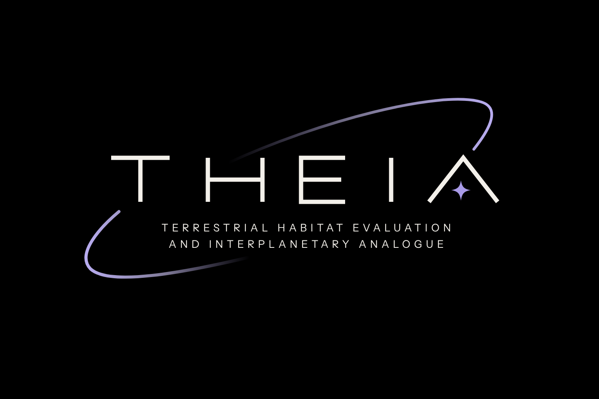
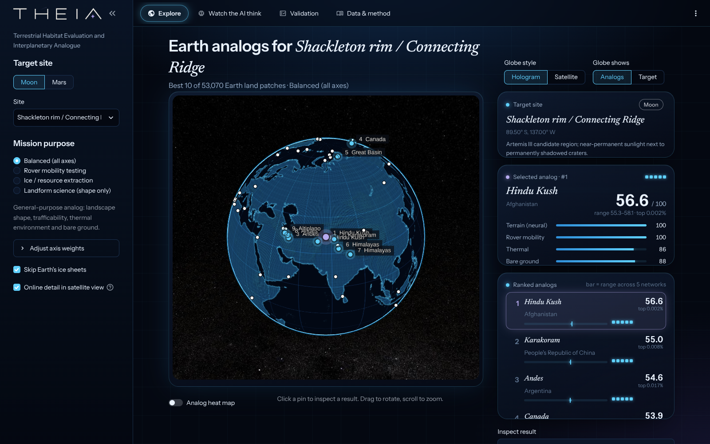
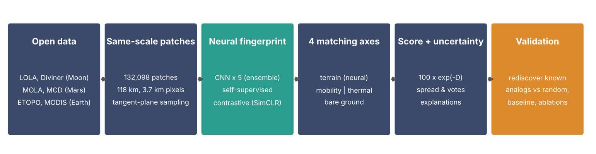

<p align="center"></p>

# THEIA

**Terrestrial Habitat Evaluation and Interplanetary Analogue: finding Earth analogs for Moon and Mars
bases with a learned, shared terrain fingerprint.**
NASA Space Apps Challenge 2026: *Identify Earth Locations that Analog the Permanent Moon Base Locations and Mars*.

THEIA is a website built with Streamlit. **AnalogNet** is the neural matching model inside it: the
5-network ensemble that turns terrain into fingerprints.

You pick a site on the Moon or Mars (for example the Artemis III candidate regions at the lunar south
pole, or Jezero crater). THEIA then searches about 53,000 Earth land patches and shows the
best-matching places on Earth on an interactive 3-D globe. Each result comes with:

- a **match score with an uncertainty bar** and **votes** from an ensemble of 5 neural networks
- a breakdown along **four axes**: terrain shape (neural), rover mobility, thermal environment and
  bare ground, weighted by mission purpose
- a **"why this matches"** panel with a feature-by-feature comparison and saliency maps
- **validation**: does the model rediscover the analog sites experts already use?





---

## 1. Run it

You need **Python 3.10-3.13** (from python.org). Internet is needed once, for the first install.

| System | How |
|---|---|
| Windows | double-click `run_windows.bat` |
| macOS / Linux | `./run_mac_linux.sh` |
| Any (manual) | `pip install -r requirements.txt`, then `python streamlit_app.py` (or `streamlit run streamlit_app.py`) |

The website opens at http://localhost:8501. To put THEIA online under **your own domain** (Docker
with automatic HTTPS, or Railway / Render / Fly.io), follow **`DEPLOY.md`**.

**The globe.** It opens in a **holographic** style (dot-matrix continents, glowing coastlines).
Switch to **Satellite** for THEIA's 16384 x 8192 true-colour globe, built from MODIS MCD43A4 imagery
via Microsoft Planetary Computer. When you zoom in close with internet available, a live
**Sentinel-2 (10 m)** mosaic takes over.

**Light on hardware.** Every globe image is cut into small tiles that load only for what is on
screen, and the globe redraws only when something changes. Zooming is instant and the GPU sits idle
when you are not moving the globe.

---

## 2. What happens inside, in 6 steps

1. **Same ruler everywhere.** Elevation maps of Earth (ETOPO 2022), the Moon (LRO LOLA) and Mars
   (MGS MOLA) are cut into square patches **118 km wide with 3.7 km pixels**. Each patch is sampled on
   a flat local grid laid on the sphere, so a lunar patch covers exactly as much ground as an Earth
   patch and the poles are not stretched. Patch centres are spread evenly over each sphere with a
   Fibonacci lattice. Result: **132,098 patches**.
2. **Terrain fingerprint (the neural network).** A small convolutional network (about 0.18 million
   weights) turns each 32x32 elevation patch into **32 numbers**. It is trained by **self-supervised
   contrastive learning** (SimCLR). It sees two randomly altered views of the same landscape (shifted
   up to 74 km, rotated, mirrored, blurred, noisy) and must recognise that they belong together, out of
   hundreds of decoys. Earth, Moon and Mars patches are mixed in every batch. **No human labels.**
3. **Four matching axes.**
   - *terrain*: distance between neural fingerprints
   - *mobility*: slope and roughness statistics, which is what a rover feels
   - *thermal*: mean, day-night swing, maximum and minimum surface temperature (Diviner on the Moon,
     Mars Climate Database on Mars, MODIS on Earth)
   - *exposure*: share of bare ground. The Moon and Mars have no vegetation; on Earth this comes from
     MODIS NDVI plus glacier masks.

   Each distance is divided by its typical value, and a **mission preset** sets the weights (rover
   testing, ice/resources, landform science, balanced).
4. **Score and uncertainty.** `score = 100 x exp(-D)`, where 100 means identical and about 37 means a
   typical random place. Five networks trained with different seeds and data subsets each give a score.
   Their **spread is the error bar**, and the number of networks ranking a site in their top 100 is the
   **vote**. The calibration of these votes is tested (leave-one-network-out).
5. **Explanation.** For every match: which features agree or disagree (in standard deviations), plus
   **occlusion saliency**, which hides one 30 km square at a time to see which landforms drive the
   similarity.
6. **Validation.** A list of 32 Earth sites that scientists already use as analogs (Atacama, Haughton
   crater, Death Valley, McMurdo Dry Valleys and others) is **never used for training**. We test
   whether the model ranks them highly, compared with random land sites (with a p-value), with a
   **non-neural baseline** (cosine similarity on raw features) and with **ablations** (one axis removed
   at a time). Results: see `RESULTS.md` and the app's *Validation* tab.

---

## Key findings (from `RESULTS.md`)

All numbers come from `python streamlit_app.py build evaluate`. Known analog sites were never used for training or for
choosing weights.

| | Mars analogs (28 sites) | Moon analogs (13 sites) |
|---|---|---|
| **Best method** | AnalogNet balanced (4 axes) | Neural terrain fingerprint only |
| Mean site score (random land = 70) | **86.1** | **93.8** |
| Known sites in Earth's top 10 % (random = 19 %) | **65 %** | **83 %** |
| AUC / p vs random | 0.76 / 0.0005 | 0.73 / 0.0005 |
| Non-neural baseline (raw features), AUC / p | 0.52 / 0.05 | 0.44 / 0.87 |

1. **Both kinds of known analog are rediscovered far better than chance** (p ≤ 0.0005), and much
   better than the non-neural baseline.
2. **Moon analogs are about landforms; Mars analogs are about environment.**
   - For the Moon, the learned **terrain fingerprint alone** is the best method (83 % of known lunar
     analogs in Earth's top 10 %). Raw hand-made features are no better than chance.
   - For Mars, the neural terrain axis adds nothing on its own (AUC 0.49). Rediscovery is driven by
     the **bare-ground (MODIS)** axis: without it the AUC drops from 0.76 to 0.55.

   This is the strongest argument for **multi-axis, purpose-weighted matching**: no single similarity
   measure fits both worlds.
3. **Per-target check:** top-20 matches for Mars targets fall near known Mars analogs **3.8x** more
   often than random. For lunar targets this happens **2.1x** more often with the shape-only preset,
   but only 0.24x with the balanced preset, which drifts toward cold high mountains.
4. **Uncertainty is informative but slightly over-confident:** when all 4 other networks vote for a
   site, a held-out 5th agrees 91 % of the time (ideal 100 %). ECE is about 0.07.
5. **Honest limitation:** a linear classifier can still tell which body a fingerprint came from 85 % of
   the time (raw features: 79 %). The shared space is not body-agnostic yet; a domain-adversarial term
   is the obvious next step.

---

## 3. What is where

```
streamlit_app.py     ALL the code, in numbered sections:
                       1 config        2 sites         3 data sources   4 sampling
                       5 features      6 global grids  7 MODIS          8 Earth texture
                       9 neural net   10 training     11 matching      12 report
                      13 3-D globe    14 the website  15 build pipeline 16 entry point
assets/              trained 5-network ensemble + processed open data
static/              globe tiles, fonts, logo, images, and the globe page + CesiumJS (static/globe)
.streamlit/          Streamlit settings (theme, static serving)
*.md                 README, DEPLOY, RESULTS, DEFENSE_GUIDE, PITCH, LITERATURE, HACKATHON_CHECKLIST
```

## 4. Rebuild everything from the original data (optional)

```
pip install -r requirements-data.txt
python streamlit_app.py build all        # or one step at a time:
python streamlit_app.py build download   # NASA PDS (LOLA, MOLA, Diviner), NOAA ETOPO, MCD, Natural Earth (~3.5 GB)
python streamlit_app.py build modis      # MODIS LST + NDVI from Microsoft Planetary Computer
python streamlit_app.py build dataset    # grids, patches, features
python streamlit_app.py build names      # offline place names
python streamlit_app.py build surface    # MODIS temperature + bare ground for Earth
python streamlit_app.py build texture    # true-colour Earth globe (MODIS MCD43A4)
python streamlit_app.py build hologram   # hologram globe textures
python streamlit_app.py build tiles      # cut globe textures into tiles (fast zoom)
python streamlit_app.py build train      # 5-network ensemble (~40-60 min on a laptop CPU)
python streamlit_app.py build evaluate   # validation numbers + maps
python streamlit_app.py build results    # writes RESULTS.md
python streamlit_app.py build zip        # release zip
```

## 5. Data and licences

All data are open. See `streamlit_app.py` §3 or the app's *Data & method* tab for exact products,
URLs and citations.

- **Moon:** LRO LOLA LDEM_16, LRO Diviner GCP (NASA PDS, public domain)
- **Mars:** MGS MOLA MEGDR (NASA PDS, public domain); Mars Climate Database v6.2 (LMD/ESA/CNES; free
  for research, citation required)
- **Earth:**
  - NOAA ETOPO 2022 (public domain)
  - MODIS MYD11A2 LST and MYD13A1 NDVI (NASA LP DAAC via Microsoft Planetary Computer, open)
  - NASA POWER / MERRA-2 (CC BY 4.0, gap filling)
  - Natural Earth (public domain)
- **Globe imagery:** MODIS MCD43A4 (via Microsoft Planetary Computer), Sentinel-2 L2A (Copernicus, live
  via Planetary Computer), NASA Solar System Treks (Moon/Mars, online).
- **Software:** Streamlit (Apache 2.0), CesiumJS (Apache 2.0), Plotly (MIT), PyTorch (BSD), NumPy,
  SciPy, scikit-learn, matplotlib. Fonts: Instrument Sans and Newsreader (SIL Open Font License).

Project code: see `LICENSE`.

## 6. Honest limitations

- Regional scale only: 3.7 km pixels and 118 km patches. Rocks, soil and metre-scale roughness are not seen.
- No mineralogy/lithology layer covering all three bodies yet, so the lava-tube/cave purpose is planned, not implemented.
- Mars temperatures come from a climate model (MCD). MODIS measures at 13:30 and 01:30, which are not the exact daily extremes.
- The fingerprint still carries some "which body is this?" information (measured in the Validation tab).
- "New candidate" analogs are hypotheses for field checking, not proven analogs.

**AI disclosure:** this software was developed with substantial help from an AI coding assistant.
The team reviewed, ran and is responsible for all code and claims. Declare this as
required by the Space Apps rules.
