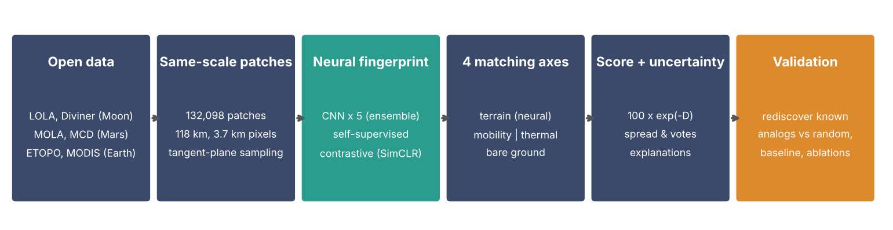
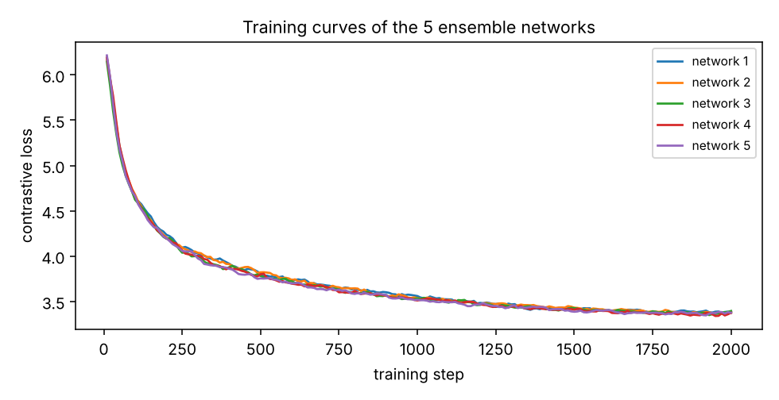
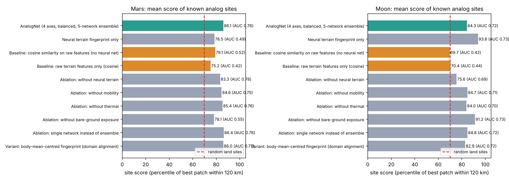
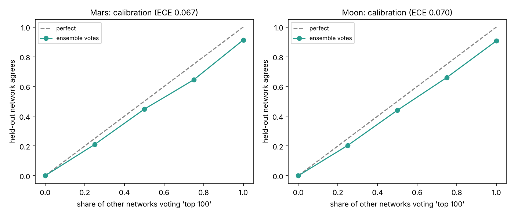

# THEIA (AnalogNet model) - results

*Generated automatically by `python streamlit_app.py build results` from `assets/validation.json`. Do not edit by hand.*

## Set-up

- Earth candidates: 53,070 land patches (ice sheets excluded), 118 km footprint, 3.7 km pixels.
- Body-likeness of an Earth patch = mean distance to its 20 nearest Moon/Mars patches (8,000-patch reference sample), turned into a percentile.
- **Site score** of a known analog = best percentile within 120 km of the site. Random baseline and p-value from 2,000 random sets of land sites of the same size.
- Known analog sites were never used for training, for choosing weights or for any design decision.

## Training

| Network | Seed | Minutes (CPU) | Final loss | Twin found | Body mixing |
|---|---|---|---|---|---|
| 1 | 2026 | 6.2 | 3.379 | 39% | 0.32 |
| 2 | 2027 | 12.3 | 3.372 | 39% | 0.31 |
| 3 | 2028 | 12.9 | 3.396 | 39% | 0.32 |
| 4 | 2029 | 7.0 | 3.377 | 41% | 0.31 |
| 5 | 2030 | 7.1 | 3.376 | 40% | 0.30 |

*Twin found*: share of augmented views for which the network picks the true partner out of 2x256-1 candidates (chance below 0.4 %). *Body mixing*: 1 = Earth/Moon/Mars neighbours perfectly interleaved, 0 = separate islands.

## Mars analogs (28 known sites)

| Method | Mean site score | Median | In top 10 % | In top 5 % | AUC | p vs random |
|---|---|---|---|---|---|---|
| AnalogNet (4 axes, balanced, 5-network ensemble) | 86.1 | 95.2 | 65% | 50% | 0.759 | 0.0005 |
| Neural terrain fingerprint only | 78.5 | 82.1 | 27% | 8% | 0.494 | 0.8296 |
| Baseline: cosine similarity on raw features (no neural net) | 79.1 | 81.8 | 27% | 12% | 0.522 | 0.0535 |
| Baseline: raw terrain features only (cosine) | 75.2 | 82.6 | 23% | 15% | 0.422 | 0.8686 |
| Ablation: without neural terrain | 83.3 | 95.8 | 62% | 54% | 0.781 | 0.0005 |
| Ablation: without mobility | 84.6 | 94.5 | 62% | 50% | 0.747 | 0.0005 |
| Ablation: without thermal | 85.4 | 92.1 | 58% | 38% | 0.763 | 0.0005 |
| Ablation: without bare-ground exposure | 78.1 | 78.9 | 35% | 15% | 0.545 | 0.4083 |
| Ablation: single network instead of ensemble | 86.4 | 95.8 | 69% | 54% | 0.757 | 0.0005 |
| Variant: body-mean-centred fingerprint (domain alignment) | 86.0 | 94.5 | 65% | 42% | 0.769 | 0.0005 |
| *Random land sites (expected)* | 69.8 | - | 19% | - | 0.5 | - |

Per-site scores (AnalogNet / raw-feature baseline):

- Atacama Desert (Yungay), Chile: 98.4 / 87.8
- Haughton impact structure, Devon Island, Canada: 99.9 / 82.1
- Death Valley, USA: 95.7 / 94.7
- McMurdo Dry Valleys, Antarctica: 80.8 / 89.3
- Hanksville / MDRS, Utah, USA: 94.6 / 75.1
- Rio Tinto, Spain: 52.8 / 56.6
- Dallol / Danakil Depression, Ethiopia: 87.1 / 76.7
- Askja / Holuhraun, Iceland: 99.8 / 81.5
- Mauna Kea / Mauna Loa (HI-SEAS), Hawaii, USA: 65.7 / 67.7
- Svalbard (AMASE), Norway: 98.2 / 89.4
- Pilbara, Western Australia: 48.7 / 78.3
- Qaidam Basin, China: 98.9 / 93.3
- Namib Desert, Namibia: 99.5 / 82.6
- Dhofar, Oman (AMADEE-18): 96.7 / 90.2
- Makhtesh Ramon, Negev, Israel: 99.0 / 65.1
- San Francisco Volcanic Field / Black Point, Arizona, USA: 90.5 / 59.2
- Craters of the Moon, Idaho, USA: 62.2 / 77.2
- Licancabur / Altiplano-Puna, Chile-Bolivia: 99.7 / 94.8
- Ladakh (Tso Kar), India: 96.6 / 99.9
- Erfoud (Ibn Battuta Centre), Morocco: 96.6 / 76.5
- Chott el Jerid, Tunisia: 91.6 / 96.1
- Kilbourne Hole / Potrillo volcanic field, New Mexico, USA: 96.5 / 58.6
- Lonar crater, India: 50.2 / 47.1
- Arkaroola, South Australia: 88.9 / 88.9
- Axel Heiberg Island, Canada: 93.8 / 99.0
- Mount Etna, Italy: 55.7 / 48.0
- Lanzarote, Canary Islands, Spain: None / None
- Teide, Tenerife, Spain: None / None

**Per-target check:** of the top-20 Earth matches of each mars target, 10% lie within 250 km of a known mars analog, vs 3% of random land patches (**3.79x lift**, balanced preset).
With the *landform (shape only)* preset: 6.1% (**2.24x lift**).

**Calibration:** expected calibration error of the ensemble votes = 0.0673 (60 random targets, leave-one-network-out, bins with at least one vote). Held-out agreement: 1/4 votes -> 21% (ideal 25%), 2/4 votes -> 45% (ideal 50%), 3/4 votes -> 64% (ideal 75%), 4/4 votes -> 91% (ideal 100%). The votes are slightly over-confident.

**New candidate analogs** (best-scoring regions at least 300 km from any known analog):

| # | Place | Lat, Lon | Score | Relief | Bare | T min / max |
|---|---|---|---|---|---|---|
| 1 | Greenland, Greenland | 81.52, -29.91 | 100.00 | 1162 m | 96% | -37 / 6 C |
| 2 | Baffin Island, Canada | 70.29, -72.66 | 100.00 | 880 m | 94% | -41 / 8 C |
| 3 | Knud Ramussen Land, Greenland | 80.88, -58.75 | 100.00 | 1372 m | 97% | -40 / 3 C |
| 4 | Altyn-Tagh, People's Republic of China | 38.43, 89.0 | 100.00 | 2355 m | 98% | -22 / 38 C |
| 5 | Kunlun Mountains, People's Republic of China | 35.57, 82.49 | 100.00 | 1146 m | 99% | -28 / 29 C |
| 6 | Knud Ramussen Land, Greenland | 77.21, -65.89 | 100.00 | 1494 m | 91% | -38 / 5 C |
| 7 | People's Republic of China | 41.75, 94.12 | 99.90 | 802 m | 100% | -22 / 55 C |
| 8 | King Christian IX Land, Greenland | 66.23, -38.45 | 99.90 | 1804 m | 90% | -27 / 5 C |
| 9 | Ustyurt Plateau, Kazakhstan | 43.35, 55.44 | 99.90 | 95 m | 100% | -18 / 50 C |
| 10 | Patagonia, Argentina | -47.52, -69.96 | 99.90 | 405 m | 95% | -12 / 37 C |
| 11 | Greenland, Greenland | 72.02, -52.43 | 99.80 | 1941 m | 86% | -38 / 5 C |
| 12 | Canada | 60.73, -139.84 | 99.80 | 1897 m | 92% | -28 / 5 C |

*Shape-only (neural landform) candidates* - added after seeing the validation (best method for lunar analogs); blind to environment, so some are vegetated:

| # | Place | Lat, Lon | Score | Relief | Bare |
|---|---|---|---|---|---|
| 1 | Selva, Colombia | 1.72, -71.98 | 100.00 | 65 m | 0% |
| 2 | Nubian Desert, Sudan | 19.66, 33.13 | 100.00 | 58 m | 97% |
| 3 | Canadian Shield, Canada | 47.9, -75.66 | 100.00 | 116 m | 0% |
| 4 | Central Lowlands, United States of America | 46.69, -94.5 | 100.00 | 86 m | 1% |
| 5 | Congo basin, Democratic Republic of the Congo | 1.37, 25.67 | 99.90 | 76 m | 0% |
| 6 | Guiana Highlands, Suriname | 4.02, -57.81 | 99.90 | 111 m | 0% |
| 7 | Uruguay | -31.91, -54.4 | 99.90 | 97 m | 0% |
| 8 | Guiana Highlands, Brazil | 1.7, -54.84 | 99.90 | 111 m | 0% |
| 9 | Kazakhstan | 46.99, 55.83 | 99.90 | 123 m | 11% |
| 10 | horn of Africa, Somalia | 9.13, 49.83 | 99.90 | 425 m | 100% |
| 11 | Libyan Desert, Sudan | 13.83, 28.57 | 99.90 | 81 m | 15% |
| 12 | North European Plain, Lithuania | 54.19, 23.99 | 99.90 | 87 m | 0% |

## Moon analogs (13 known sites)

| Method | Mean site score | Median | In top 10 % | In top 5 % | AUC | p vs random |
|---|---|---|---|---|---|---|
| AnalogNet (4 axes, balanced, 5-network ensemble) | 84.3 | 83.5 | 25% | 17% | 0.716 | 0.005 |
| Neural terrain fingerprint only | 93.8 | 97.5 | 83% | 75% | 0.728 | 0.0005 |
| Baseline: cosine similarity on raw features (no neural net) | 69.7 | 77.6 | 0% | 0% | 0.425 | 0.6417 |
| Baseline: raw terrain features only (cosine) | 70.4 | 76.0 | 33% | 25% | 0.439 | 0.8661 |
| Ablation: without neural terrain | 75.6 | 75.8 | 25% | 25% | 0.688 | 0.0315 |
| Ablation: without mobility | 84.7 | 82.0 | 25% | 17% | 0.71 | 0.002 |
| Ablation: without thermal | 84.0 | 84.1 | 25% | 17% | 0.701 | 0.0105 |
| Ablation: without bare-ground exposure | 91.2 | 94.8 | 67% | 50% | 0.732 | 0.0025 |
| Ablation: single network instead of ensemble | 84.8 | 84.1 | 25% | 17% | 0.721 | 0.007 |
| Variant: body-mean-centred fingerprint (domain alignment) | 82.9 | 81.7 | 25% | 17% | 0.717 | 0.011 |
| *Random land sites (expected)* | 69.9 | - | 19% | - | 0.5 | - |

Per-site scores (AnalogNet / raw-feature baseline):

- Haughton impact structure, Devon Island, Canada: 88.8 / 78.9
- Askja / Holuhraun, Iceland: 98.3 / 81.8
- Mauna Kea / Mauna Loa (HI-SEAS), Hawaii, USA: 81.5 / 76.3
- Noerdlinger Ries crater, Germany: 78.5 / 30.8
- San Francisco Volcanic Field / Black Point, Arizona, USA: 93.6 / 84.0
- Craters of the Moon, Idaho, USA: 84.8 / 87.8
- Tolbachik, Kamchatka, Russia: 83.6 / 87.7
- Sudbury impact structure, Canada: 76.5 / 36.7
- Mistastin crater, Labrador, Canada: 64.9 / 58.2
- Kilbourne Hole / Potrillo volcanic field, New Mexico, USA: 99.3 / 88.3
- Lonar crater, India: 83.5 / 64.9
- Mount Etna, Italy: 78.6 / 60.8
- Lanzarote, Canary Islands, Spain: None / None

**Per-target check:** of the top-20 Earth matches of each moon target, 0% lie within 250 km of a known moon analog, vs 1% of random land patches (**0.24x lift**, balanced preset).
With the *landform (shape only)* preset: 2.6% (**2.12x lift**).

**Calibration:** expected calibration error of the ensemble votes = 0.0696 (60 random targets, leave-one-network-out, bins with at least one vote). Held-out agreement: 1/4 votes -> 20% (ideal 25%), 2/4 votes -> 44% (ideal 50%), 3/4 votes -> 66% (ideal 75%), 4/4 votes -> 91% (ideal 100%). The votes are slightly over-confident.

**New candidate analogs** (best-scoring regions at least 300 km from any known analog):

| # | Place | Lat, Lon | Score | Relief | Bare | T min / max |
|---|---|---|---|---|---|---|
| 1 | Altiplano, Argentina | -26.61, -68.0 | 100.00 | 2119 m | 93% | -11 / 42 C |
| 2 | Karakum Desert, Uzbekistan | 42.82, 57.52 | 100.00 | 169 m | 100% | -19 / 52 C |
| 3 | Kyzyl Kum, Uzbekistan | 41.97, 63.9 | 100.00 | 433 m | 100% | -17 / 57 C |
| 4 | Altyn-Tagh, People's Republic of China | 38.43, 89.0 | 100.00 | 2355 m | 98% | -22 / 38 C |
| 5 | Kunlun Mountains, People's Republic of China | 35.84, 82.92 | 100.00 | 871 m | 100% | -28 / 30 C |
| 6 | Mongolian Plateau, Mongolia | 44.74, 104.25 | 100.00 | 364 m | 96% | -30 / 50 C |
| 7 | Arabian Peninsula, Saudi Arabia | 27.03, 39.13 | 100.00 | 245 m | 100% | 4 / 56 C |
| 8 | Andes, Argentina | -30.88, -69.83 | 100.00 | 2755 m | 95% | -10 / 39 C |
| 9 | Sahara, Libya | 23.54, 15.59 | 100.00 | 382 m | 100% | 4 / 54 C |
| 10 | Sahara, Algeria | 27.29, 2.36 | 100.00 | 198 m | 100% | 7 / 58 C |
| 11 | Rub' al Khali, Saudi Arabia | 18.84, 44.94 | 99.90 | 356 m | 100% | 8 / 58 C |
| 12 | Sahara, Libya | 24.78, 11.18 | 99.90 | 351 m | 100% | 4 / 56 C |

*Shape-only (neural landform) candidates* - added after seeing the validation (best method for lunar analogs); blind to environment, so some are vegetated:

| # | Place | Lat, Lon | Score | Relief | Bare |
|---|---|---|---|---|---|
| 1 | Cordillera Blanca, Peru | -7.62, -78.37 | 100.00 | 2857 m | 0% |
| 2 | Cordillera Occidental, Peru | -15.4, -73.68 | 100.00 | 3107 m | 33% |
| 3 | Adamawa Plateau, Cameroon | 5.24, 11.49 | 100.00 | 437 m | 0% |
| 4 | Chalbi Desert, Kenya | 2.74, 37.02 | 100.00 | 630 m | 57% |
| 5 | Loma Mountains, Sierra Leone | 9.03, -11.48 | 99.90 | 453 m | 0% |
| 6 | Eastern Ghats, India | 11.75, 77.94 | 99.90 | 702 m | 0% |
| 7 | Arabian Peninsula, Saudi Arabia | 27.03, 39.13 | 99.90 | 245 m | 100% |
| 8 | Cordillera Blanca, Peru | -11.23, -75.04 | 99.90 | 3502 m | 0% |
| 9 | Altiplano, Argentina | -26.61, -68.0 | 99.90 | 2119 m | 93% |
| 10 | Andes, Argentina | -32.18, -70.16 | 99.90 | 3102 m | 83% |
| 11 | Serra da Mantiquiera, Brazil | -22.76, -44.72 | 99.90 | 1593 m | 0% |
| 12 | Nigeria | 8.82, 8.16 | 99.90 | 438 m | 0% |

## What the network learned

- Body identity from the fingerprint (logistic regression, 5-fold CV): **85%** vs 79% from raw terrain features (chance 33%).
- Hand-made terrain properties readable from the fingerprint (cross-validated R2 of a linear read-out):

  - slope_mean_deg: 0.851
  - elev_std_m: 0.844
  - relief_m: 0.841
  - pit_depth_m: 0.83
  - curvature: 0.829
  - slope_p90_deg: 0.828
  - rough_mid_m: 0.826
  - rough_small_m: 0.818
  - hypsometric: 0.693
  - elev_skew: 0.529
  - pit_density: 0.386
  - anisotropy: 0.345

## How to read these results honestly

- A mean site score well above the random value, with a small p-value, means the method ranks the places experts use as analogs higher than chance. AUC 0.5 = chance, 1.0 = perfect.
- Compare AnalogNet with the raw-feature baseline and with *neural terrain only*: this shows what the neural fingerprint adds and what the other axes add. If a simpler method scores as well, say so.
- Known analogs were chosen by experts for many reasons (geology, access, history). A perfect score is neither expected nor desirable.
- The bare-ground axis rewards deserts and polar deserts. Most known analogs are deserts, so check the *without bare-ground* ablation to see how much of the result comes from this single, physically motivated axis.
